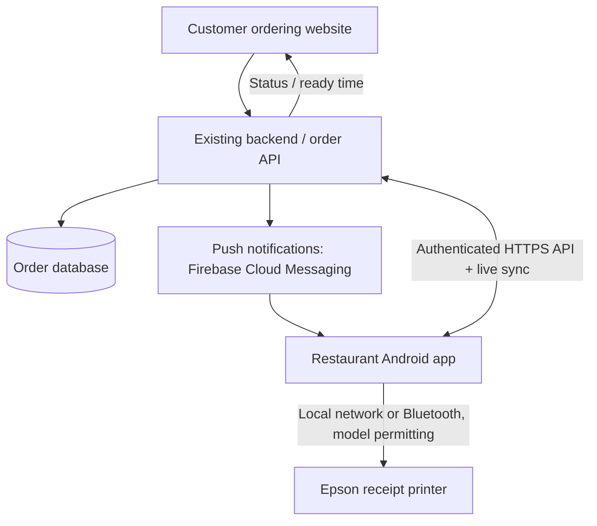

# Restaurant Android Order-Taking App — Implementation Plan

## 1. Goal

Replace GloriaFood's restaurant-side order-taking and printing workflow with a custom Android application, while keeping the existing customer-facing online ordering website.

The restaurant uses an **Android mobile phone**. Staff should receive new-order notifications, accept or reject orders, select an estimated ready time, print accepted orders on an Epson receipt printer, and mark orders ready.

## 2. Proposed architecture



**Responsibility boundaries**

- **Website:** customer ordering experience and order-status display.
- **Backend:** authoritative order state, payment verification, estimated ready time, staff authorization, notifications, and durable print-job records.
- **Android app:** staff alerts, order review, accept/reject, select ready time, print and reprint controls.
- **Epson printer:** thermal kitchen tickets over a connection supported by the exact printer model.

## 3. Customer-to-kitchen workflow

1. Customer places an order on the existing website.
2. Backend verifies the order/payment state and stores it with a unique order ID.
3. Backend sends a Firebase Cloud Messaging (FCM) notification to the restaurant device.
4. Android app alerts staff and fetches the full order from the authenticated backend API.
5. Staff reviews items, modifiers, pickup/delivery details, and notes.
6. Staff selects **15, 30, 45 minutes**, or a custom ready time, then accepts; alternatively rejects the order with a reason.
7. Backend atomically updates the order status and stores an absolute `estimatedReadyAt` timestamp.
8. Customer website displays the updated status and confirmed estimated ready time; optional email/SMS notifications can be added later.
9. Android app queues a kitchen ticket to the Epson printer, including the ready time.
10. Staff marks the order ready; backend updates the customer-facing status.

**Recommended print trigger:** after staff acceptance, so the printed ticket includes the confirmed ready time.

## 4. Suggested tech stack

| Layer | Suggested technology | Purpose |
| --- | --- | --- |
| Android app | Kotlin + Jetpack Compose | Native Android staff interface |
| Push alerts | Firebase Cloud Messaging | Notify staff when orders arrive |
| Live updates | WebSockets or Server-Sent Events, plus reconciliation | Keep order list current |
| HTTP client | Retrofit/OkHttp | Authenticated backend communication |
| Local persistence | Room | Cache orders and track local print state |
| Deferred work | WorkManager (with Android limitations in mind) | Retry eligible non-urgent work |
| Epson printing | Epson ePOS SDK for Android **if supported by the model** | Printer integration |
| Backend | Reuse existing website backend | Single source of truth |

A browser-only Android page cannot reliably provide the same printer access as a native integration. A native app is the preferred option for this project.

## 5. Suggested order state model

```text
PENDING -> ACCEPTED -> PREPARING -> READY -> COMPLETED
   |
   +-----> REJECTED
```

Keep **printing state separate** from order state:

```text
NOT_QUEUED -> QUEUED -> SENDING -> PRINTED
                         |          
                         +-> FAILED / UNCERTAIN
```

A network write or socket close is not proof that paper printed successfully. Design for printer status checks when supported, visible failures, manual reprints, and avoiding accidental duplicate prints. If the outcome is uncertain, surface it to staff rather than silently retrying indefinitely.

## 6. Minimum backend API

| Method | Endpoint | Purpose |
| --- | --- | --- |
| `GET` | `/api/restaurant/orders` | List outstanding orders |
| `GET` | `/api/restaurant/orders/:id` | Fetch order details |
| `POST` | `/api/orders/:id/accept` | Accept and set ready time |
| `POST` | `/api/orders/:id/reject` | Reject with reason |
| `PATCH` | `/api/orders/:id/ready` | Mark ready |
| `POST` | `/api/devices/register` | Register Android push token |
| `POST` | `/api/orders/:id/print-events` | Record print outcomes (authenticated) |

Example accept request:

```http
POST /api/orders/1042/accept
Content-Type: application/json
Authorization: Bearer <access-token>

{
  "preparationMinutes": 30
}
```

Example response (illustrative):

```json
{
  "id": "1042",
  "status": "ACCEPTED",
  "estimatedReadyAt": "2026-11-17T14:00:00+01:00"
}
```

**Backend rules:** check staff permissions and restaurant ownership; enforce valid state transitions; use idempotency for accept/reject operations; compute `estimatedReadyAt` on the server; store all timestamps unambiguously (prefer UTC internally); never trust a push notification as the authoritative order record.

## 7. Android app screens

### A. Login / connection
- Staff authentication and restaurant selection, if needed.
- Notification-permission guidance and printer connection/status indicator.

### B. New orders
- Audible and visible alert for incoming orders.
- Customer, items, quantities, modifiers, payment and pickup/delivery summary.
- Preparation-time buttons: **15 / 30 / 45 minutes** and a custom option.
- **Accept** and **Reject** actions.

### C. Active orders
- Accepted and preparing orders with their promised ready times.
- **Mark ready** action.
- Visible printer status, failed prints, and manual **Reprint** button.

### D. Order history
- Search by order number and date; inspect previous printing/acceptance events.

## 8. Epson integration plan

1. **Identify exact Epson model** (e.g. TM-m30II, TM-T20III, TM-T88VII) and interface variant.
2. Confirm that it supports **Epson ePOS SDK for Android** and determine connection type (LAN/Wi-Fi/Bluetooth/USB).
3. For network printing, connect the phone and printer to a reachable local network; avoid exposing the printer directly to the public internet.
4. Implement device discovery or known-printer configuration, connection status, and a test-print function.
5. Format kitchen ticket with order number, creation/acceptance time, ready time, items, modifiers, notes, and pickup/delivery type.
6. Queue prints on acceptance, store print attempts, and show actionable errors.
7. Test reconnection after network interruptions, paper-out conditions, printer power cycling, and duplicate notifications.

> The exact printer model is required before choosing SDK calls or a concrete transport. Not every Epson printer supports the same commands or connection methods.

## 9. Notifications and background limitations

Use FCM for new-order notifications and an audible channel permitted by Android settings. On recent Android versions, notification permissions and device power-management rules affect delivery and sound. High-priority messages can help for time-sensitive visible notifications, but **FCM is not a guaranteed immediate-delivery queue**.

Mitigations:

- Persist orders on the backend before notifying.
- Fetch outstanding orders on app launch, resume, and reconnection.
- Maintain live updates while the app is active.
- Display an offline/connection-warning state.
- Prefer **printing after staff accepts in the foreground**, rather than promising unattended printing while the phone is sleeping or the app is force-stopped.

## 10. Security and reliability checklist

- [ ] Require authenticated staff sessions and role checks.
- [ ] Use HTTPS for all backend communications.
- [ ] Keep printer access within trusted local networking/Bluetooth.
- [ ] Verify payment through the payment provider/backend, not a browser-supplied flag.
- [ ] Use unique order IDs, idempotent actions, and explicit state transitions.
- [ ] Treat print failures independently of order acceptance.
- [ ] Allow safe manual reprinting with audit history.
- [ ] Reconcile all pending orders after reconnect or app restart.
- [ ] Handle concurrent staff actions and duplicate notifications.
- [ ] Retain only necessary customer information and enforce appropriate access controls.
- [ ] Test with screen locked, battery restrictions enabled, weak Wi-Fi, and printer offline.

## 11. MVP implementation phases

### Phase 1 — Backend and order states
Implement listing, accepting with preparation time, rejecting, and marking ready. Update customer-visible status.

### Phase 2 — Android order-taking UI
Create login, new-order list, details, time selector, and active-orders screen.

### Phase 3 — Push notifications and synchronization
Integrate FCM, notifications, live status, reconnect reconciliation, and foreground alert sound.

### Phase 4 — Epson printer
Integrate the correct Epson SDK/connection, print test, kitchen-ticket template, print status, and reprint actions.

### Phase 5 — Production hardening
Test failures, background behavior, concurrency, authorization, monitoring and operational support.

## 12. Information needed for implementation-specific code

- **Epson printer:** exact model and whether it uses Ethernet/Wi-Fi/Bluetooth/USB.
- **Existing website/backend:** framework and hosting (e.g. Next.js, Express, Django, etc.).
- **Order database:** PostgreSQL, MySQL, Firebase, etc.
- **Payment flow:** whether order acceptance should happen only after payment confirmation.
- **Number of restaurants/devices/printers:** one location or multiple.
- **Ready time preference:** relative preparation minutes, specific clock time, or both.

## 13. MVP acceptance criteria

- A confirmed customer order becomes visible on the Android device without manually refreshing while online.
- Staff can accept with an estimated ready time, or reject with a reason.
- Customer website reflects the server-confirmed status and ready time.
- Accepted orders print a legible kitchen ticket on the actual Epson device.
- Failed/uncertain printing is visible and staff can reprint.
- Restarting the Android app does not lose outstanding orders.
- Duplicate notifications do not create duplicate orders or unintended extra prints.

---

**Recommended first implementation:** complete the backend order-state endpoints and the Kotlin order-acceptance screen before adding Epson printing. This keeps the core restaurant workflow testable without hardware.
